# DocketPilot (prototype)

Verifiable legal research and drafting for Indian law, any area of practice: 35 Central Acts (BNS, BNSS, BSA, CPC,
Contract, family, property, consumer, arbitration, ...), ~16,000 Supreme Court and High Court judgments, and any document
type. Section 138 NI Act (cheque bounce) has the deepest rule support (fixed templates, deadline rules, ingredient checklist).
**Not legal advice. Nothing here was reviewed by a lawyer.** Full design: [docs/SPEC.md](docs/SPEC.md).
What was built and what was cut: [docs/DECISIONS.md](docs/DECISIONS.md). Measured results: [reports/EVALUATION_REPORT.md](reports/EVALUATION_REPORT.md);
comparison with LegalMind and other systems: [reports/COMPARISON.md](reports/COMPARISON.md).

## Screenshots

The case shown is a made-up divorce matter (H.M.O.P. No. 214 of 2026) used for testing.

**1. Home page.** The public front page: the project title, what DocketPilot does, and buttons to start. A real DocketPilot draft sits in the background.

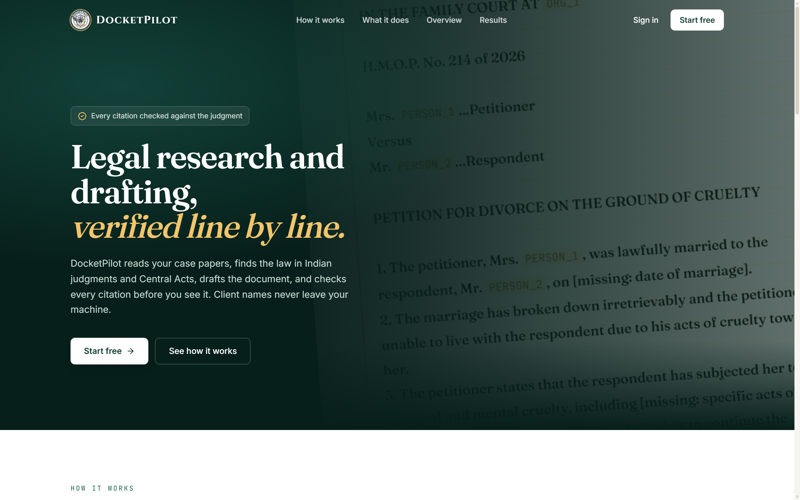

**2. Sign in.** Sign in or create an account in a panel that slides in from the right (Google sign-in too). Each account has its own private workspace.

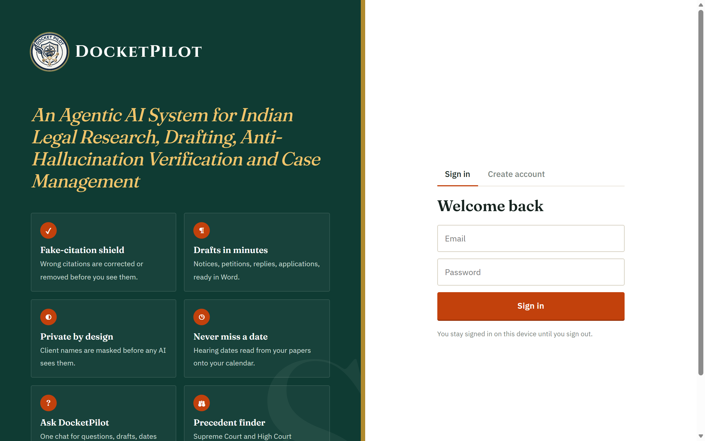

**3. Dashboard.** The lawyer's day at a glance: shortcuts to draft, ask, find a section or check citations; counts of active cases, hearings this week and drafts waiting; upcoming hearings and recent cases.

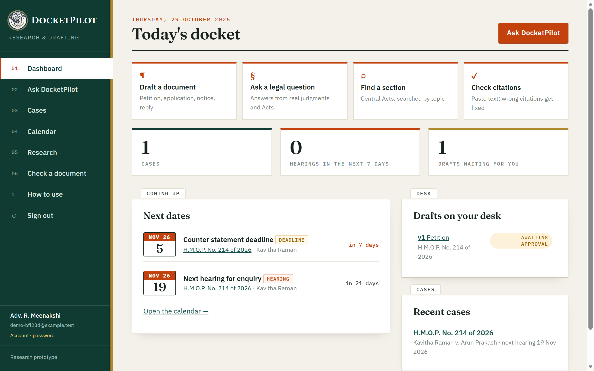

**4. Privacy check before the AI sees anything.** After a case paper is uploaded, every name, place and address found in it is listed with the placeholder that will replace it (`PERSON_1`, `ADDRESS_1`, ...). The lawyer can untick false hits or add missed names, then files it. Only the masked text goes to the AI.

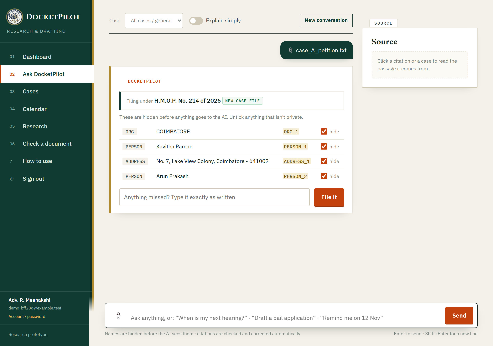

**5. A verified answer.** Ask a legal question in plain words. The answer quotes real judgments and Acts, and every reference is checked against the source; here 8 references were checked and 6 that could not be supported were removed. The panel on the right explains the marks: verified, check, problem.

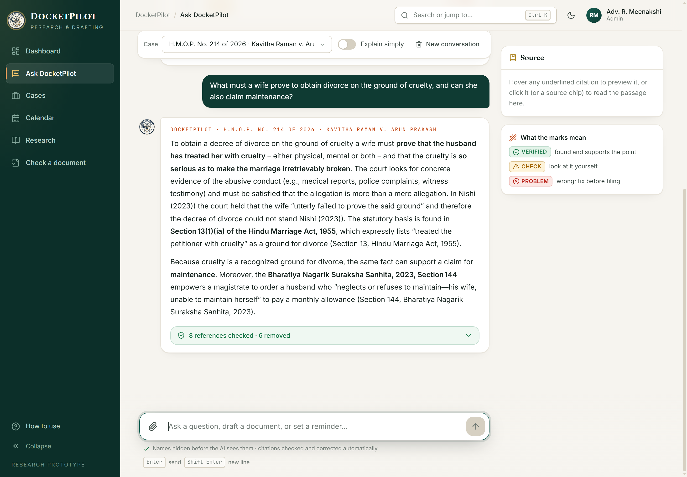

**6. Find a section.** Search 35 Central Acts by topic ("divorce cruelty desertion") and read the exact section text, with its India Code source link. No AI is used here.

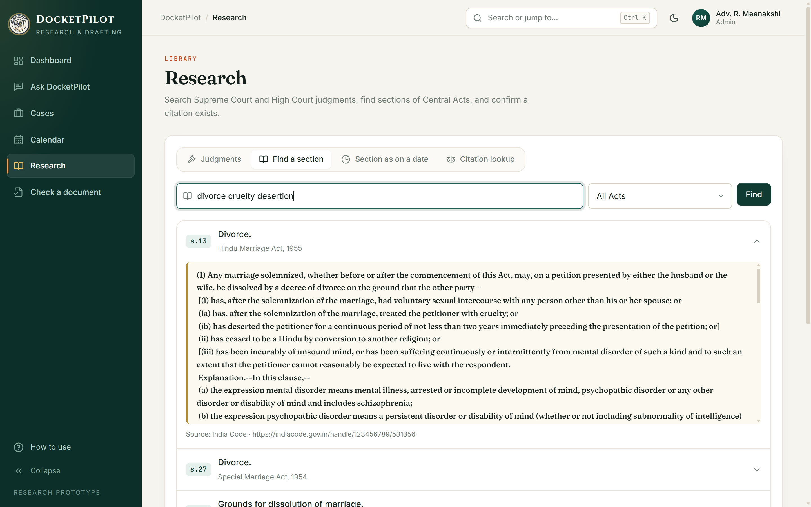

**7. Drafting in progress.** A draft runs through seven steps: plan, read papers, research, draft, verify, checklist of missing facts, deadlines. It usually takes one to three minutes.

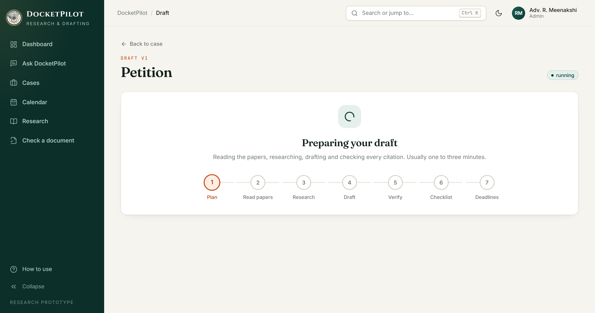

**8. Draft review.** The finished draft with its verification result ("Clear to approve"). Clicking a citation shows the passage from the judgment it rests on, on the right. Facts the papers did not give appear as `[missing: ...]`. Real names are put back only in the downloaded Word file.

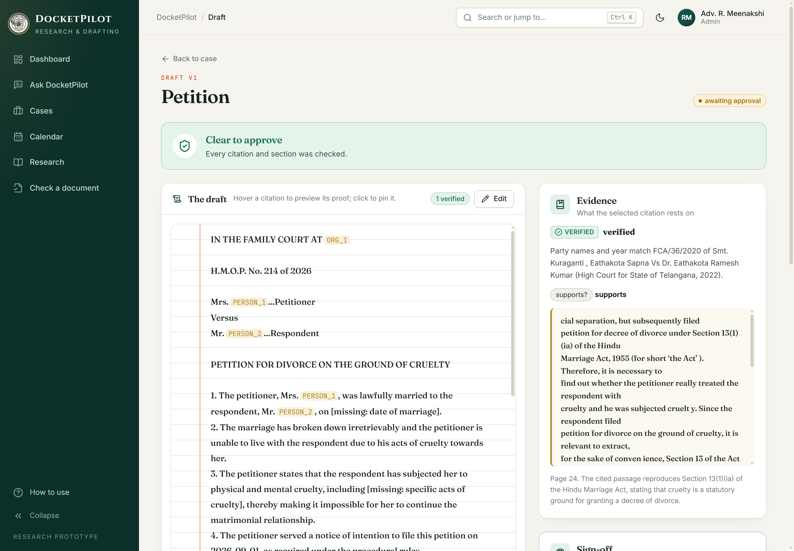

**9. Calendar.** Hearings, deadlines and orders are read from the case papers. Each date links to the sentence it came from, so it can be checked. Reminders can be added by hand.

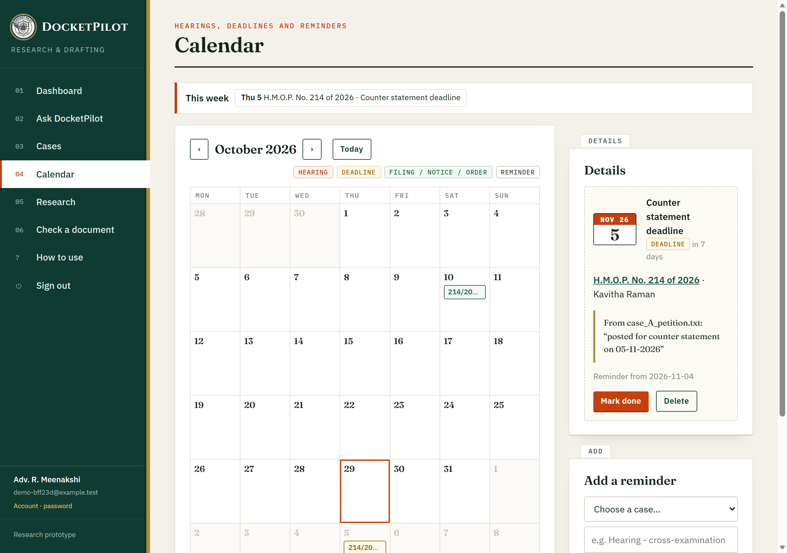

**10. On a phone.** The same app works on a small screen: the menu folds away and the chat fills the width.

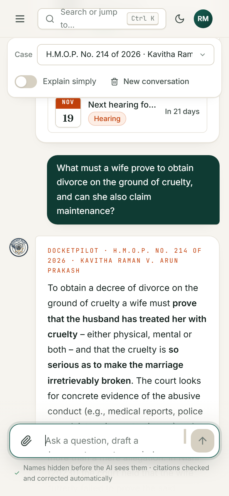

**11. Exam prep (AIBE).** Practice questions and timed mock tests for the All India Bar Examination, made straight from the bare Acts with no AI. After each answer the section it comes from is shown, and the score is broken down by subject.

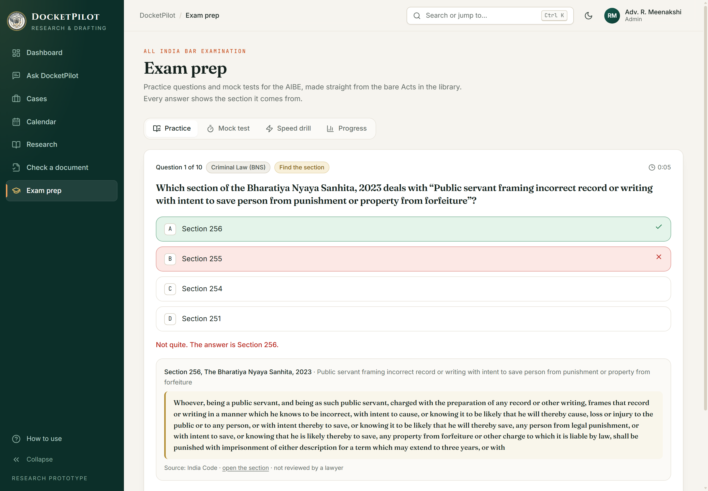

## Start it (one command)

Needs Docker Desktop running.

```powershell
.\start.ps1
```

Then open **http://127.0.0.1:8000** in a browser. Stop with `Ctrl+C`; stop the databases with `docker compose stop`.

**Accounts.** Anyone can click **Create account** (name, email, password of 8+ characters). Each account gets its own
private workspace; nobody sees anyone else's cases. You stay signed in on that browser for a week after your last visit
(every visit renews it) until you click **Sign out**.

**Google sign-in (optional).** The button appears once a Google OAuth client id is set:
1. https://console.cloud.google.com → create a project → *APIs & Services* → *OAuth consent screen* (External, add your email as a test user).
2. *Credentials* → *Create credentials* → *OAuth client ID* → type **Web application** → *Authorised JavaScript origins*: `http://127.0.0.1:8000` and `http://localhost:8000`.
3. Copy the client id into `.env` as `GOOGLE_CLIENT_ID=....apps.googleusercontent.com` and restart.

**AI quota.** Groq's free tier allows 8,000 tokens a minute and 200,000 a day. One verified answer or draft uses roughly
5,000-15,000 tokens, so expect about 20-40 AI actions a day per key (a second key in `GROQ_API_KEY_BACKUP`
and up to two more in `GROQ_API_KEY_BACKUP_2` and `_3`, each from a different Groq account, are used automatically when one runs out; same model); answers may take up to two minutes when the minute budget is busy.
Search, statutes, calendar, cases and citation look-ups do not use the AI. For real use, move to Groq's paid Dev tier
(no code change).

## What you can do in the browser

0. **Ask DocketPilot**: chat about the law or a judgment. Answers come only from real judgments and statutes,
   every citation is stamped verified / check / problem, and names you type are masked before the AI sees them.
   Pick a matter to get its strengths, weaknesses and next steps.
1. **Matters → New matter**, then upload the case papers (.pdf with text, .docx or .txt).
2. Check the **redaction preview**: what will be masked before anything goes to the AI. Add missed names, un-mask false hits, confirm.
3. **Draft it**: type any document (bail application, divorce petition, reply to notice, written statement, legal notice,
   ...) and optionally what it should say, or just type "Draft a bail application ..." in the chat. Seven agents run: fact
   extraction → research (statutes + judgments) → drafting → **verification** → checklist of missing facts and similar cases →
   reminders. Cheque-bounce notice/complaint use the fixed Section 138 templates.
4. Review the draft: every citation is green / amber / red; click one to see its evidence passage. Red items **block** approval; amber items must be ticked as checked.
5. **Approve** → download the Word file (real names restored only now, with a removable verification appendix) and the deadlines calendar (.ics).
6. **Research**: search judgments, **find the section** by topic across 35 Acts, look up "Section X as on date D", look up a
   citation. **Check a document**: paste any text; wrong citations come back corrected.
7. **Exam prep** (AIBE): practise one subject, take a 100-question timed mock test, or a speed drill (type the section number in
   45 seconds); Progress shows your weakest subjects. Questions are built from the bare Acts with no AI and no Groq tokens
   (17 of the 19 AIBE subjects; not the Constitution or PIL yet). Check them: `python -m docketpilot.evaluation.exam_check`.

## Rebuild the knowledge base

```powershell
.\.venv\Scripts\python.exe -m docketpilot.ingestion.download --sc-from 2015   # ~4 GB, resumable (data/raw/)
.\.venv\Scripts\python.exe -m docketpilot.ingestion.load       # judgments + 35 Acts into PostgreSQL; safe to re-run
.\.venv-gpu\Scripts\python.exe -m docketpilot.retrieval.index --gpu --scope all --collection chunks_all   # GPU vectors
# no NVIDIA GPU? .\.venv\Scripts\python.exe -m docketpilot.retrieval.index  (CPU, s.138 judgments only)
```

## Check and evaluate

```powershell
.\check.ps1                                                      # lint + type check + tests
.\.venv\Scripts\python.exe -m docketpilot.evaluation.run_all --e2e   # writes reports/EVALUATION_REPORT.md
.\.venv\Scripts\python.exe -m docketpilot.evaluation.benchmark_vs     # vs baseline AI (cost, speed, hallucination)
.\.venv\Scripts\python.exe -m docketpilot.evaluation.comparison       # writes reports/COMPARISON.md
```

## Layout

| Path | What |
|---|---|
| `docketpilot/api/` | FastAPI endpoints; `web/index.html` is the browser app |
| `docketpilot/ingestion/` | Download and load open judgment data |
| `docketpilot/knowledge/` | Citations (find + normalise), judgment parsing, statutes with dates |
| `docketpilot/retrieval/` | Tiered search: exact lookup, keyword, vector, fusion, reranking |
| `docketpilot/privacy/` | PII detection, redaction, encrypted vault |
| `docketpilot/verification/` | The citation verifier (spec Section 8) |
| `docketpilot/agents/` | The seven agents (LangGraph) with the approval pause |
| `docketpilot/rules/` + `data/rules/` | Deadlines and the s.138 checklist, as data with statute quotes |
| `docketpilot/drafting/` + `data/templates/` | Court-style templates and Word output |
| `docketpilot/evaluation/` | Benchmarks and the report generator |
| `prompts/` | Versioned LLM prompts |
| `discovery/` | Phase 0 data-discovery scripts |
| `vault/` | Encrypted placeholder maps per matter (never share; needs `VAULT_KEY` from `.env`) |

## Services (all on 127.0.0.1 only)

| Service | Port | Role |
|---|---|---|
| DocketPilot API + web | 8000 | FastAPI (runs from `.venv`) |
| PostgreSQL 16 | 5432 | Cases, citations, statutes, matters, audit log, agent checkpoints |
| Qdrant | 6333 | Vector search |
| Redis | 6379 | Reserved for cache / job queue |
| SeaweedFS (S3) | 8333 | Reserved for file storage |

Data licences: Supreme Court and High Court judgments from the AWS Open Data Registry, CC-BY-4.0
(source and licence stored per case). Statutes from India Code (indiacode.gov.in).
